<div align="center">

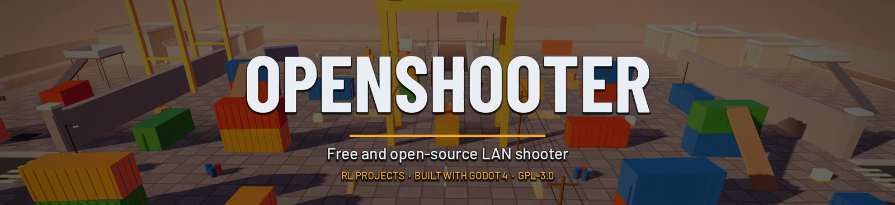

<h3>Free and open-source LAN shooter</h3>

<p>
  <a href="https://godotengine.org/"></a>
  <a href="LICENSE"></a>
  <a href="https://docs.godotengine.org/en/stable/tutorials/rendering/renderers.html"></a>
</p>

<p>
  
  
  
  
</p>

<p>
  <a href="#getting-started"><b>Getting started</b></a> ·
  <a href="#how-to-play"><b>How to play</b></a> ·
  <a href="#android"><b>Android</b></a> ·
  <a href="#controls"><b>Controls</b></a> ·
  <a href="#weapons"><b>Weapons</b></a> ·
  <a href="#trailer"><b>Trailer</b></a>
</p>

</div>

---

**OpenShooter** is a free and open-source first-person shooter for the local
network, built with **Godot 4.7** and the **Compatibility** renderer. It is
designed to run well on modest hardware — including integrated GPUs — while
still offering fast movement, precise gunplay, several maps and a full set of
game modes.

> Original concept and implementation: *Linha de Fogo*. This project is the
> English-language continuation, renamed **OpenShooter** and released under the
> GNU General Public License v3.0.

---

## Screenshots

| Main menu | Mode selection |
|---|---|
| 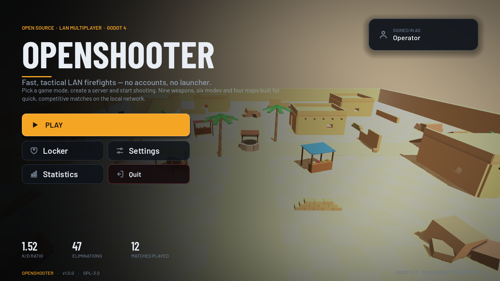 | 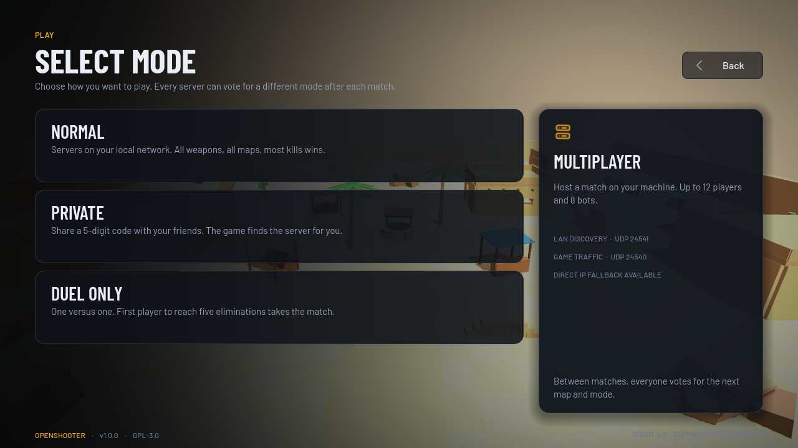 |

| Create server | In-match HUD |
|---|---|
| 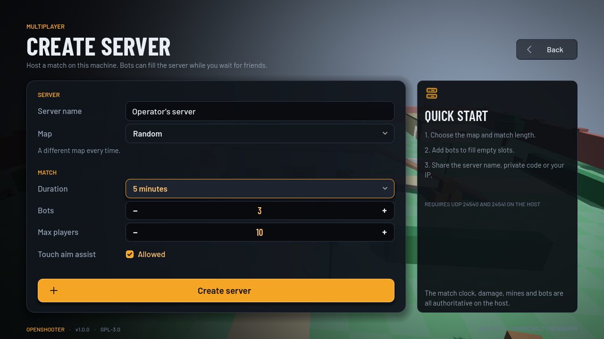 | 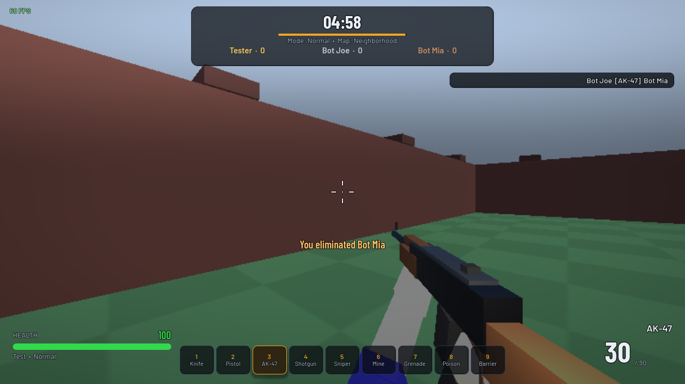 |

| Scoreboard | Voting |
|---|---|
| 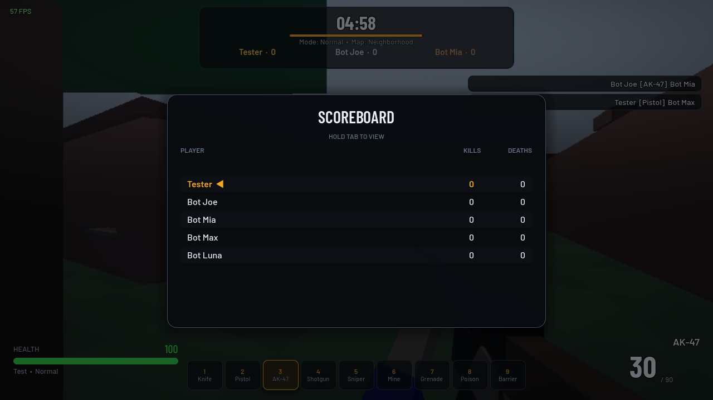 | 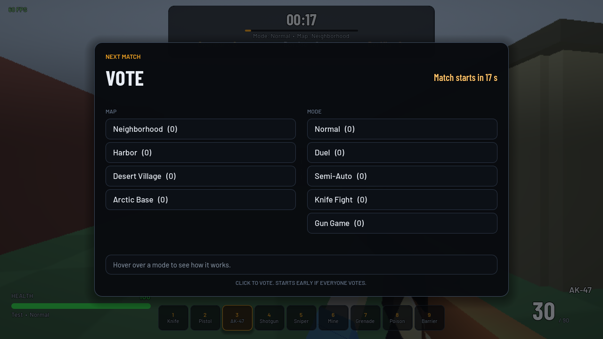 |

| Locker | Settings |
|---|---|
| 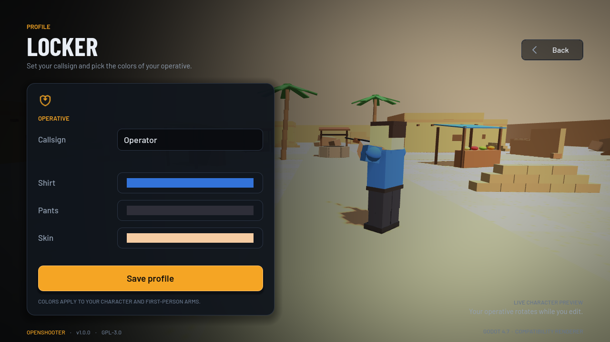 | 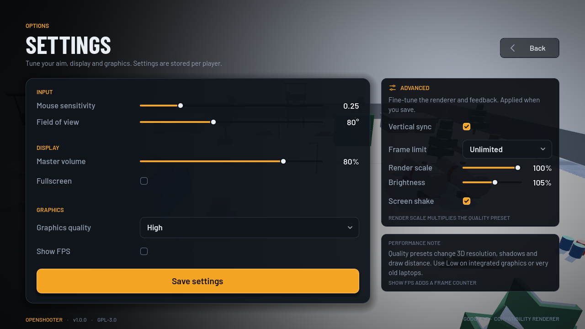 |

| Statistics | Server browser |
|---|---|
| 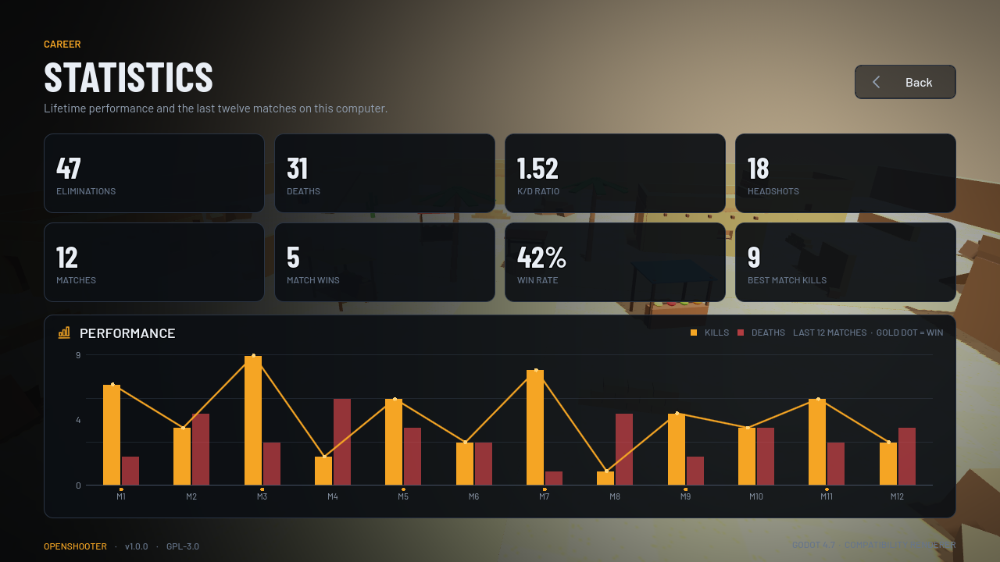 | 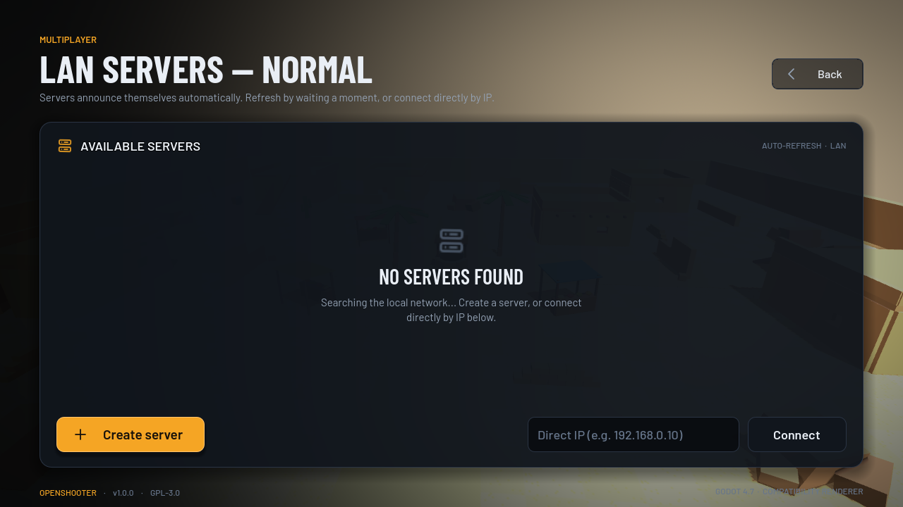 |

| Android touch HUD | Loading screen |
|---|---|
| 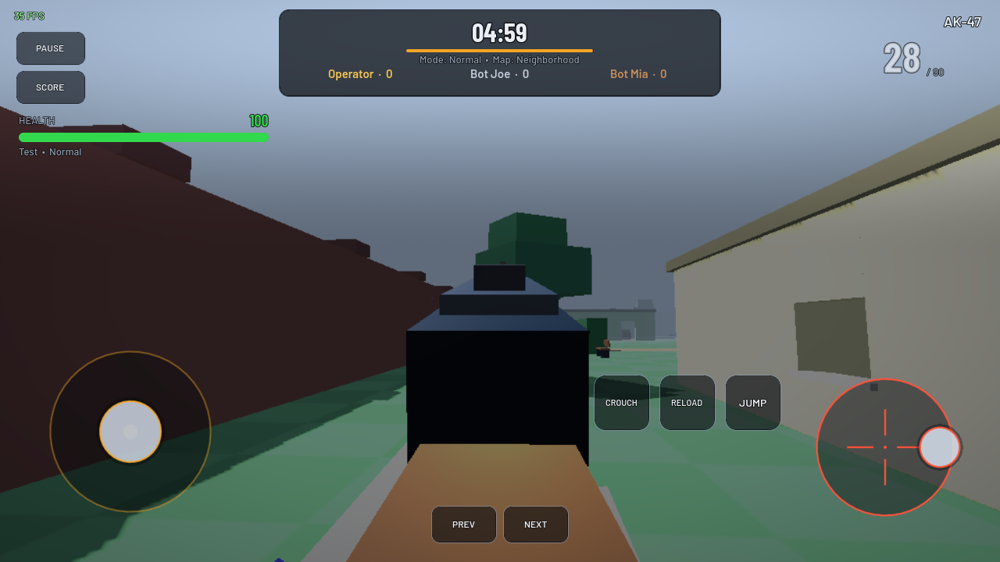 | 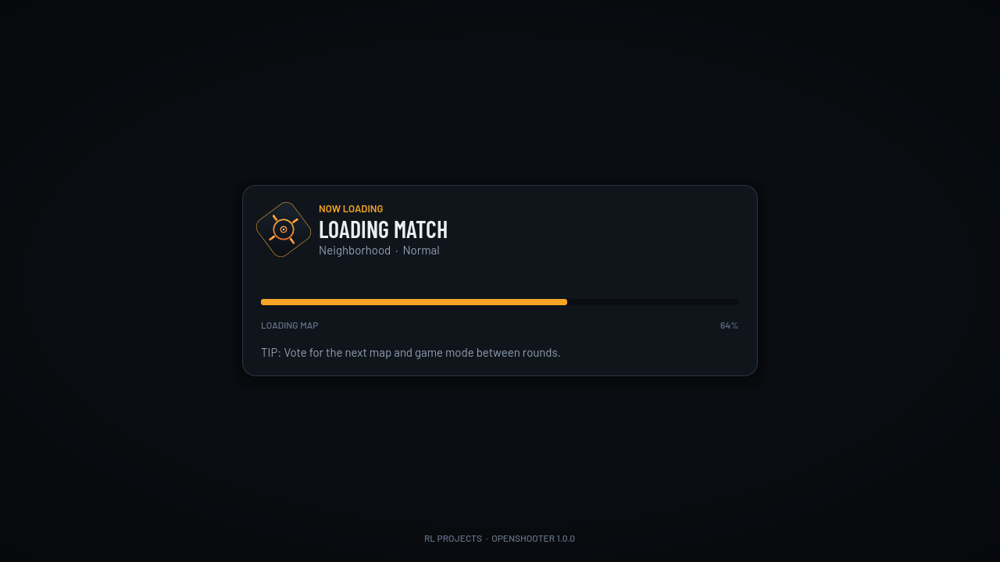 |

| Studio splash | Author credit |
|---|---|
| 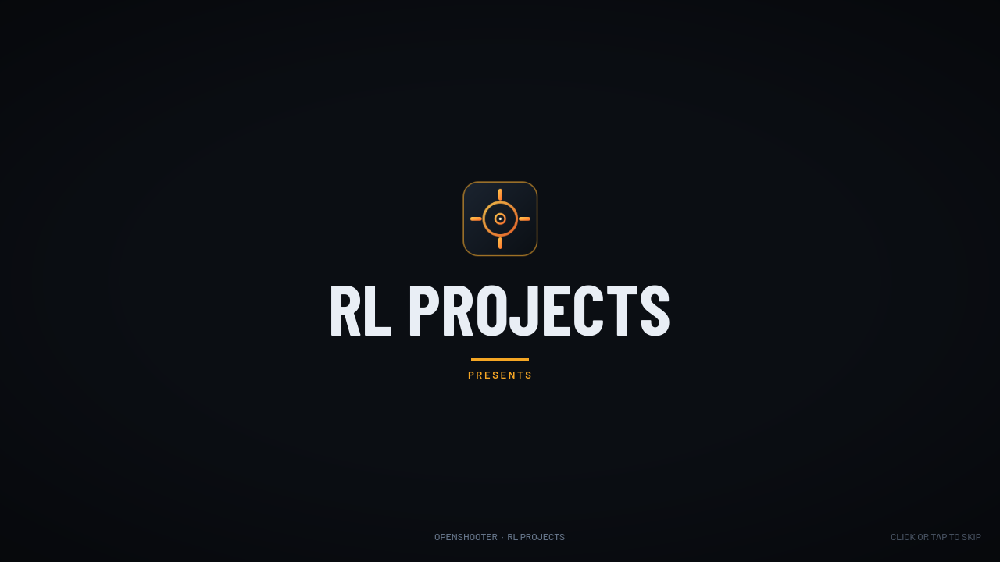 | 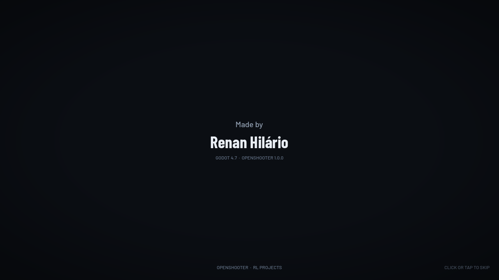 |

---

## Table of contents

- [Highlights](#highlights)
- [Requirements](#requirements)
- [Getting started](#getting-started)
- [How to play](#how-to-play)
- [Android](#android)
- [Controls](#controls)
- [Weapons](#weapons)
- [Game modes](#game-modes)
- [Graphics quality](#graphics-quality)
- [Statistics and performance](#statistics-and-performance)
- [Networking](#networking)
- [Command-line options](#command-line-options)
- [Project structure](#project-structure)
- [UI and design system](#ui-and-design-system)
- [Performance notes](#performance-notes)
- [Trailer](#trailer)
- [Contributing](#contributing)
- [Credits](#credits)
- [License](#license)

---

## Highlights

- **LAN multiplayer** with automatic server discovery, direct IP connection and
  private matches protected by a 5-digit code.
- **Up to 12 players** per server, plus up to **8 bots** for offline play.
- **4 large maps**: a handcrafted core plus a themed outer district (about
  150 × 150 m) with extra streets, buildings, rooftops and cover.
- **5 game modes** with map/mode voting between rounds.
- **9 weapons and equipment items**, each with its own data sheet that can be
  edited in the Inspector.
- **Procedural character animation**: walking, sprinting, crouching, jumping,
  aiming, reloading, recoil and death — without animation files.
- **Block-based level design**: maps, props, weapons and characters are built
  from editable `Block` nodes that are merged into a single mesh at runtime.
- **Modern interface**: custom dark theme, icon set, cinematic overlays,
  animated screen transitions and a responsive HUD designed for 16:9 displays.
- **Studio splash and real loading screens**: RL PROJECTS startup sequence,
  author credit, and a progress screen that loads the world and map in the
  background.
- **Scales to weak hardware**: chunked maps, distance culling, detail LOD,
  depth fog and quality presets.
- **Android port**: touch joystick, action buttons, mobile HUD layout and
  direct-IP LAN play on phones.
- **Player profile**: nickname, outfit colors, persistent statistics and
  per-player settings.

---

## Requirements

| Requirement | Details |
|---|---|
| Engine | Godot **4.7** (standard build, not .NET required) |
| Renderer | Compatibility (OpenGL 3.3 / OpenGL ES 3.0) |
| OS | Linux, Windows, FreeBSD, Android 7.0+ (macOS should work but is not tested) |
| Network | LAN with UDP ports **24540** and **24541** open |
| Native module (optional) | C compiler (the scripts use `zig cc`); Android NDK 27+ for the Android library |

A discrete GPU is not required. The default *Medium* preset targets integrated
graphics such as Intel HD 4400.

---

## Getting started

### Run from the editor

```sh
git clone <repository-url>
cd OpenShooter   # or the name of the folder you cloned into
godot -e --path .
```

Press **F5** (Run Project) in the editor.

### Run without the editor

```sh
godot --path .
```

If your Godot binary has a different name (for example `godot-fedora` or
`Godot_v4.7-stable_linux.x86_64`), use that command instead.

### Native C module (optional)

The heavy map bake can run in a small **C GDExtension** in `native/`. It is
optional: without it the game uses the GDScript mesher. To build it:

```sh
./native/build.sh linux     # desktop Linux .so
./native/build.sh windows   # .dll
./native/build.sh android   # Android arm64 + arm32 (needs the NDK)
./native/build.sh freebsd   # native FreeBSD .so
./native/build.sh all
```

The extension is compiled outside the Godot editor. After rebuilding, reload
the project (or restart the editor). `--no-native` forces the GDScript path.
On FreeBSD, `./native/build.sh freebsd` uses the system compiler and the native
Godot 4.7 port (`pkg install godot-4.7`).

### Startup and loading

The game opens with two short splash cards — **RL PROJECTS** and then
**Feito por Renan Hilário** — before the main menu. Click, tap or
press any key to skip them. The default Godot boot splash is disabled, so the
dark OpenShooter background is the first thing on screen.

Starting or joining a match shows a real loading screen: the match scene and the
selected map are loaded on a background thread while the progress bar and status
line report **LOADING MATCH**, **LOADING MAP**, **BUILDING WORLD** and
**READY**. The world then reuses the already loaded map instead of loading it a
second time.

### Prebuilt builds

Ready-to-run packages are generated under `dist/`:

| Platform | Package |
|---|---|
| Windows x86_64 | `dist/OpenShooter-1.0.0-windows-x86_64.zip` |
| Linux x86_64 | `dist/OpenShooter-1.0.0-linux-x86_64.tar.xz` (19 MB, recommended for sharing) |
| Linux x86_64 (alternative) | `dist/OpenShooter-1.0.0-linux-x86_64.tar.gz` / `.zip` |
| FreeBSD x86_64 (native) | `dist/OpenShooter-1.0.0-freebsd-x86_64.tar.gz` / `.zip` |
| Android arm64 | `dist/OpenShooter-1.0.0-android-arm64.apk` (~27 MB, recommended) |
| Android universal | `dist/OpenShooter-1.0.0-android-universal.apk` (~51 MB, arm64 + armeabi) |

Checksums are in `dist/SHA256SUMS.txt`. These are local build artifacts and are
ignored by Git; attach them to a GitHub release if you want to distribute them.

The Windows build is a single unsigned `.exe`. The Linux package contains the
executable, a launcher script, the GPL license, the application icon and a
short README; the executable bit is preserved in the tar.xz, tar.gz and zip.
The `.tar.xz` uses the x86 BCJ filter and is about 20 MiB, small enough for
Discord's upload limit.

### Export a build

The project includes `export_presets.cfg` with single-file Windows and Linux
presets (`embed_pck = true`). Install the matching **Godot 4.7.2 export
templates** (Editor → Manage Export Templates, or the official `.tpz` package),
then run:

```sh
godot --headless --path . --export-release "Windows Desktop" build/windows/OpenShooter.exe
godot --headless --path . --export-release "Linux" build/linux/OpenShooter.x86_64
```

The Windows preset embeds `assets/icons/openshooter.ico` as the executable
icon. The project uses the Compatibility renderer, so no special rendering
features are required.

---

## How to play

The main menu offers three ways to play:

1. **Normal** — lists every server found on the local network. You can join
   one, create your own server, or connect directly by IP.
2. **Private** — the host receives a **5-digit code**; other players type the
   code and the game locates the server on the LAN automatically.
3. **Duel Only** — a 1v1 lobby. The first player to reach **5 kills** wins the
   match.

When creating a server you can choose the name, map, number of bots (up to 8),
match duration and player slots.

### Between rounds

Every match begins with a **vote** for the next map and game mode. You can walk
around during voting, but weapons are disabled. If every human player votes,
the countdown is shortened automatically. Ties are broken randomly.

### In a match

- Press **TAB** to see the scoreboard.
- Press **ESC** to open the in-match menu and leave the match.
- The HUD shows the timer, the top three players, health, ammo, the weapon
  hotbar, the kill feed and directional damage indicators.

---

## Android

A full Android port is included, with a touch HUD designed for landscape play.

### Install

1. Copy one of the APKs to the phone.
2. Allow **Install unknown apps** for the file manager or browser.
3. Tap the APK and install.

| APK | When to use |
|---|---|
| `OpenShooter-1.0.0-android-arm64.apk` | Most modern phones. Smaller download. |
| `OpenShooter-1.0.0-android-universal.apk` | Older 32-bit devices or if the arm64 APK is rejected. |

The APKs are signed with a development key for sideloading. They are not
signed for Google Play; use your own release keystore for store publishing.

### Mobile controls

| Control | Action |
|---|---|
| Left circle | Movement stick (drag inside it) |
| Right circle | Aim / shoot: touch to aim automatically, push past ~55% to fire |
| Drag the screen | Alternative look |
| `JUMP` / `CROUCH` | Jump / toggle crouch |
| `RELOAD` | Reload |
| `PREV` / `NEXT` | Previous / next weapon |
| `SCORE` | Toggle the scoreboard |
| `PAUSE` | In-match menu |

Touching the right aim stick enters **aim-down-sights automatically** (scoped
weapons zoom in). Keep the stick below the fire threshold to aim without
shooting; push it past the threshold to fire. Semi-automatic weapons fire once
per push; automatic weapons fire while held.

Pushing the stick fully forward enables auto-sprint.

On mobile, **Settings → Advanced → Mobile** adds:
**Movement stick** size (80–200%, default 135%), **Touch opacity** (40–100%)
and **Aim assist** (Off / Light / Standard). The stick is larger by default
than the first Android build.

### Aim assist and PC/mobile balance

Auto-fire is intentionally **not** used: it would be too strong and would make
mobile players effectively aimbots. Instead, touch players get a soft aim
assist that helps them aim without playing for them:

- **Off / Light / Standard** in Settings → Advanced → Mobile.
- Narrow cone (3.5° / 5.5°), 25 m / 35 m range and clear line of sight.
- Pulls toward the **chest**, never the head; headshots remain manual.
- Reduced while moving and strongly reduced for scoped weapons.
- Look input is slightly slowed near a target for finer control.
- Firing is still manual: push the right aim stick past the threshold.
- The host can disable it when creating a server with **Touch aim assist →
  Allowed** (uncheck for fair mixed PC/mobile matches).
- No health, damage or movement bonuses are applied to mobile players.

For competitive mixed lobbies, a Bluetooth/USB controller is the most even
option. The aim assist setting is per player; the host toggle is authoritative
for that server.

### Playing with friends

The easiest setup is to **host on a PC** (Windows or Linux) and join from the
phones with the **Direct IP** field in the server browser. The phone build also
supports hosting, but phones often restrict broadcast discovery and may sleep
in the background.

UDP ports **24540** (match) and **24541** (discovery) must be reachable on the
host. Some Android devices and Wi-Fi networks block LAN broadcast; use direct
IP if the server list stays empty.

### Android build

Requirements: Godot **4.7.2** export templates, **JDK 17** and the Android SDK
(platform 36, build-tools 36).

```sh
export JAVA_HOME=/path/to/jdk17
export ANDROID_HOME=/path/to/android-sdk
export PATH="$JAVA_HOME/bin:$ANDROID_HOME/build-tools/36.0.0:$ANDROID_HOME/platform-tools:$PATH"

godot --headless --path . --export-release "Android" build/android/OpenShooter.apk
```

The Android preset in `export_presets.cfg` uses the prebuilt APK template
(`gradle_build/use_gradle_build=false`), embeds the PCK, includes the custom
launcher icon and requests the LAN permissions. For the arm64-only build,
disable `architectures/armeabi-v7a` in the preset.

The local build uses the standard Android debug keystore for signing. Generate
a private release keystore and update `keystore/release*` in
`export_presets.cfg` before distributing through an app store.

### Size note

The FreeBSD package uses the native Godot 4.7 runtime (`pkg install godot-4.7`)
and includes the PCK plus the FreeBSD `.so`; it is not a standalone engine.

The Android APKs are **27 MB** (arm64) and **51 MB** (universal). They do not
fit Discord's 20 MB upload limit; use an external file host or split the APK
into two parts if needed.

---

## Controls

| Input | Action |
|---|---|
| `W` `A` `S` `D` | Move |
| Mouse | Look / aim |
| Left mouse | Fire / place mine / throw |
| Right mouse | Aim down sights (scope on the Sniper) |
| `SPACE` | Jump |
| `SHIFT` | Sprint |
| `CTRL` or `C` | Crouch (better accuracy) |
| `R` | Reload |
| `1`–`9` or mouse wheel | Switch weapon |
| `TAB` | Scoreboard |
| `ESC` | In-match menu / leave match |

Key bindings are defined in **Project → Project Settings → Input Map** and can
be changed without touching code.

### Bunny hop

Sprinting and jumping in quick succession builds speed: every chained hop adds
**0.45 m/s**, up to **+2.25 m/s** (sprint speed goes from 8.5 to 10.75). The
bonus resets when you stop sprinting, crouch, aim or stay on the ground too
long. The FOV widens slightly while it is active. The values (`hop_boost`,
`hop_max`, `hop_window`, `hop_decay`) are exported on the Player scene.

---

## Weapons

| # | Weapon | Damage | Notes |
|---|---|---|---|
| 1 | Knife | 55 | Melee |
| 2 | Pistol | 26 | 12 rounds, high accuracy |
| 3 | AK-47 | 22 | Automatic, 30 rounds |
| 4 | Shotgun | 9 × 13 pellets | Strong up close, damage falloff at range |
| 5 | Sniper | 80 | Scope, lethal headshots, 5 rounds |
| 6 | Mine | up to 150 | Arms in 1.5 s, explodes when an enemy steps close |
| 7 | Grenade | up to 130 | Timed fuse, area damage |
| 8 | Poison | 7 per tick | Area denial cloud |
| 9 | Barrier | — | Blocks shots and movement for a limited time |

Headshots multiply damage (from ×1.5 to ×2.2 depending on the weapon).

All numbers above are configurable in `resources/weapons/*.tres`.

---

## Game modes

| Mode | Rules |
|---|---|
| **Normal** | All weapons and equipment. Most eliminations wins. |
| **Duel** | Sniper plus one grenade; every hit is lethal. |
| **Semi-Auto** | Pistol, Shotgun and Sniper, plus a grenade and a barrier. |
| **Knife Fight** | Knives only. Get close without being seen. |
| **Gun Game** | Every kill advances you to the next weapon; win with the final Knife kill. |

Modes are data resources (`GameModeData`) in `resources/modes/` and are listed
in `scripts/game/mode_db.gd`. Grenades and the other equipment are not a
separate mode: they are part of the Normal, Semi-Auto, Duel and Gun Game
loadouts (at least one grenade in each of those modes).

---

## Graphics quality

Choose **Settings → Graphics quality**:

| Quality | 3D resolution | Shadows | Fog | Anti-aliasing |
|---|---|---|---|---|
| Low | 60% | No | No | No |
| Medium (default) | 80% | Yes, short range | Yes | No |
| High | 100% | Yes | Yes | MSAA 2× |

**Show FPS** enables a frame counter in the corner of the screen.

### Advanced options

The **Advanced** card adds working renderer and feedback controls:

| Option | Function |
|---|---|
| Vertical sync | Enables or disables display VSync |
| Frame limit | Unlimited, 60, 120 or 144 FPS (`Engine.max_fps`) |
| Render scale | 50–100% 3D resolution, multiplied by the quality preset |
| Brightness | 80–125% scene exposure, for bright or dark displays |
| Screen shake | Turns hit and explosion camera shake on or off |

All options are applied when you press **Save settings**.

Settings are stored in `user://config.cfg` together with the player name,
outfit colors and statistics.

---

## Statistics and performance

The **Statistics** screen keeps a local career record and a performance chart:

- Eight lifetime cards: eliminations, deaths, K/D ratio, headshots, matches,
  wins, win rate and best match kills.
- A **performance chart** for the last 12 matches with kills and deaths bars,
  a kill trend line and a gold marker for wins.
- Bars animate into place when the screen opens.
- Match history is stored in `user://config.cfg` under `stats.history`; nothing
  leaves your computer.

Statistics are written when a match ends and are never uploaded.

---

## Networking

- The host is the **server** (ENet, **24540/UDP**).
- Clients send their own position 30 times per second.
- The server validates every shot with a raycast against body and head hitboxes,
  then applies damage, kills, mines, bots and the match clock.
- The server announces the match over UDP broadcast on **24541/UDP**. Private
  matches only announce a hash of the code.
- If broadcast is blocked by a firewall, use **direct IP**.

The match scene always lives at `/root/Main/World` with the same path on every
computer, which is required by the RPCs.

On Android, LAN discovery can be restricted by the device or Wi-Fi network;
**Direct IP** is the reliable fallback. Hosting on a PC is recommended.

---

## Command-line options

Options are passed after `--`:

```sh
godot --path . -- --help
```

| Option | Description |
|---|---|
| `--host=normal\|private\|duel` | Start a server directly |
| `--join=IP` | Join a server |
| `--code=12345` | Private code used with `--join` |
| `--name=Player` | Player name for this window |
| `--quality=0\|1\|2` | Low, Medium or High graphics |
| `--bots=N` | Number of bots on a hosted server |
| `--map=INDEX` | Map index for a hosted server |
| `--screen=Screen[:arg]` | Open a menu screen directly (e.g. `Settings`) |
| `--autoplay` | Local player is driven by bot AI (testing) |
| `--shot=FILE.png [--wait=N]` | Save a screenshot after N seconds |
| `--bench=N` | Measure FPS for N seconds |
| `--no-native` | Disable the C mesher and use the GDScript fallback |
| `--log-native` | Print whether the C mesher is active when a map loads |
| `--help` | Print usage |

Test runs do **not** overwrite the player's saved settings or statistics.

### Automated LAN test

```sh
# Two windows that play against each other over the loopback interface
godot --path . -- --host=duel --bots=0 --autoplay &
godot --path . -- --join=127.0.0.1 --autoplay
```

### Benchmark

```sh
godot --path . -- --host=normal --bots=8 --autoplay --bench=15 --quality=1
```

---

## Project structure

```
scenes/          main, match world, maps, props, player, weapons, fx and UI
resources/       weapon and mode data, materials, environments, theme
scripts/         autoload, core, game, player, weapons, fx and UI logic
shaders/         sniper scope and UI overlay shaders
audio/           sound effects
assets/          Barlow fonts (SIL OFL), icons, cursors, platform logos, Android art
docs/            architecture guide, README banner and screenshots
tools/           UI theme generator (build_theme.gd) and trailer tools (trailer/)
native/          optional C GDExtension (map mesher) and its build script
tests/           small standalone test scenes (pickup_test.tscn)
```

See **[docs/ARCHITECTURE.md](docs/ARCHITECTURE.md)** for a detailed tour of the
code, the `Block` system, map/weapon recipes and networking internals.

---

## UI and design system

The interface uses a single generated theme, so every screen shares the same
tokens for color, typography, spacing and states.

- **Theme generator:** `tools/build_theme.gd` defines the palette (gunmetal
  surfaces, amber accent, red danger, green success), typography, rounded
  panels, buttons, inputs, sliders, popups and HUD variations. Regenerate it
  with:

  ```sh
  godot --headless --path . --script tools/build_theme.gd
  ```

- **Typography:** [Barlow](https://github.com/jpt/barlow) and Barlow Condensed
  (SIL Open Font License 1.1). The license ships in `assets/fonts/OFL.txt`.
- **Icons:** a small original SVG line-icon set in `assets/ui/icons/`, tinted by
  the theme's `icon_*_color` properties.
- **Overlays:** `shaders/ui_vignette.gdshader` and
  `shaders/ui_gradient.gdshader` add cinematic edge darkening and menu
  readability without any texture assets.
- **Screen language:** every menu screen is a self-contained scene with a
  consistent header (eyebrow, title, subtitle, Back) and card-based content.
  The in-match HUD uses translucent panels, a compact weapon hotbar, chip-style
  kill feed entries and an opaque modal layer for pause, voting and the
  scoreboard.
- **Motion:** screen transitions slide and fade, buttons scale on hover and
  press, icons breathe and tilt, modal panels pop in, and numeric HUD counters
  roll up or down when values change. Menu cards and buttons enter in a short
  cascade; in a match the hit marker pops (bigger and red on an elimination),
  the crosshair eases and blooms with each shot, kill-feed chips grow in and
  fade out, the active hotbar slot lifts, and the weapon breathes, rolls when
  strafing and lifts in the air, with a recoil camera punch that springs back.
- **Custom cursor:** a tactical arrow and text I-beam live in
  `assets/ui/cursors/` and are applied globally by the `Cursor` autoload, with
  the correct hotspots and a clean release on exit.
- **Custom controls:** `Stepper` provides animated minus/plus number fields,
  `AnimatedNumber` rolls counters, and `StatsChart` draws an animated match
  history chart.
- **Touch layer:** `TouchControls` adds a movement stick, a right aim/shoot
  stick, jump/reload/crouch buttons, weapon switching, pause and scoreboard
  controls. The HUD reflows to a compact mobile layout with health and ammo
  above the touch clusters.
- **Live feedback:** settings sliders show their current values, the HUD updates
  health color and ammo separately, and vote/scoreboard rows use stateful
  styling.

Almost every visual property can be changed in the Inspector. To add a new
button style, add a type variation in `tools/build_theme.gd` and set it on the
node with `theme_type_variation`.

---

## Performance notes

- Maps are merged into **chunks**; chunks outside the view or beyond the draw
  distance are not rendered.
- The **C mesher** (`native/`) builds each chunk as **one surface** with a
  shared shader that reads metallic, roughness and emission per vertex. It also
  builds the collision as one concave mesh per chunk instead of one box per
  block (about 64 shapes instead of 700), and removes box faces that are fully
  hidden by a neighbouring block. Combined with fewer draw calls, this makes
  the map bake about twice as fast and cuts map triangles by around 10–15%. The GDScript fallback
  still splits diffuse, metal and emissive surfaces and uses per-block collision.
- Without the native module, small non-colliding details use a separate
  **detail mesh** with a shorter draw distance and no shadows.
- Character animation only runs for visible players, at a reduced rate at
  distance.
- The camera far plane matches the draw distance, and depth fog hides the
  transition.
- In the Compatibility renderer every visible light costs an extra pass, so
  muzzle flashes are switched off completely between shots.
- HUD updates that do not need per-frame precision run at 10 Hz.
- Sounds come from a **fixed pool of voices** (16 flat, 32 positional) with
  voice stealing, instead of creating and freeing a node for every shot.
- Impact marks share one material per color instead of duplicating a material
  per hit; command-line flags and input action names are cached instead of
  being rebuilt every frame.

---

## Trailer

The trailer is recorded from real matches with bots, so it can be remade after
any visual change:

```sh
GODOT=godot tools/trailer/make_trailer.sh trailer.mp4
```

- `scripts/trailer/trailer_director.gd` films each segment: it stages
  firefights and grenade throws in front of the camera, cuts between chase,
  hero, orbit, low and flyover shots, hides the HUD and draws the letterbox,
  captions and the closing logo card. The shot list and captions live in its
  `SEGMENTS` table.
- Segments are captured with Godot's Movie Maker at a fixed 30 fps in
  1920×1080 (independent of the PC speed), then trimmed and joined with fades.
- `tools/trailer/music.py` synthesizes the original score (numpy only); its
  impacts land on the cuts and on the logo reveal. Game sounds play underneath.

Requires ffmpeg and python3 with numpy. A game window opens while each segment
records.

---

## Contributing

Contributions are welcome. Good first steps:

1. Fork the repository and create a feature branch.
2. Keep the existing code style (typed GDScript, tab indentation, doc comments
   with `##`).
3. Test both the menu and an actual LAN match (`--host` / `--join`) before
   opening a pull request.
4. Describe the change and the motivation clearly.

When adding content:

- New weapons: add a `.tres` under `resources/weapons/` and list it in
  `WeaponDB.ALL`.
- New modes: add a `.tres` under `resources/modes/` and list it in
  `ModeDB.ALL`.
- New maps: add a scene under `scenes/maps/` and list it in `MapDB.MAPS`.

Please make sure any asset you add is compatible with the GPLv3 license.

---

## Credits

- **Godot Engine** — MIT license.
- **Barlow / Barlow Condensed** by the Barlow Project Authors — SIL Open Font
  License 1.1 (`assets/fonts/OFL.txt`).
- **Original concept and implementation** — *Linha de Fogo* project.
- **UI, English localization and OpenShooter branding** — OpenShooter
  contributors.

---

## License

Copyright (C) 2026 OpenShooter contributors.

This program is free software: you can redistribute it and/or modify it under
the terms of the **GNU General Public License as published by the Free Software
Foundation, version 3 of the License**.

This program is distributed in the hope that it will be useful, but **WITHOUT
ANY WARRANTY**; without even the implied warranty of MERCHANTABILITY or FITNESS
FOR A PARTICULAR PURPOSE. See the [LICENSE](LICENSE) file for the full text.

Godot Engine is licensed separately under the MIT license.
