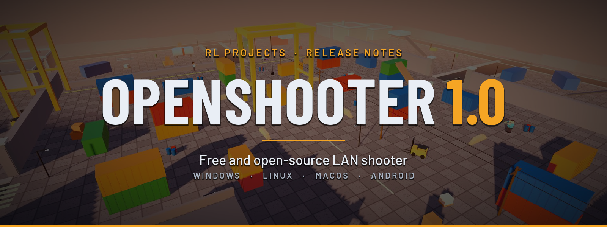
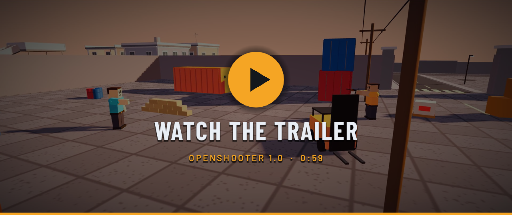

  

**OpenShooter 1.0** is the first public release of the free and open-source
LAN shooter by **RL PROJECTS**, built with Godot 4.7. Get your friends on the
same network, pick a map and play.

## Trailer

  

<b><a href="https://github.com/Renan2010p/openshooter/releases/download/v1.0.0/OpenShooter-1.0.0-trailer.mp4">▶ Watch the trailer</a></b> (0:59, 1080p) · also attached below as <code>OpenShooter-1.0.0-trailer.mp4</code>

## Downloads

| Platform | File | How to run |
|---|---|---|
| **Windows** (64-bit) | `OpenShooter-1.0.0-windows-x86_64.zip` | Extract the zip and open `OpenShooter.exe`. |
| **Linux** (x86_64) | `OpenShooter-1.0.0-linux-x86_64.tar.gz` | Extract and run `./OpenShooter.x86_64`. |
| **macOS** (Intel + Apple Silicon) | `OpenShooter-1.0.0-macos-universal.zip` | Extract, then right-click `OpenShooter.app` → **Open** the first time. |
| **Android** (arm64 + armv7) | `OpenShooter-1.0.0-android.apk` | Copy to the phone and install (allow *Install unknown apps*). |

Keep the native library (`.dll` / `.so`) next to the executable on Windows and
Linux. `SHA256SUMS.txt` lists the checksums of every file.

## Highlights

- **LAN multiplayer**: automatic server discovery, direct IP connection and
  private matches protected by a 5-digit code. Up to 12 players per server.
- **Bots**: up to 8 bots to fill a match or play offline.
- **4 maps**: Neighborhood, Harbor, Desert Village and Arctic Base, each with
  a handcrafted core and a themed outer district (about 150 × 150 m).
- **5 game modes**: Normal, Duel, Semi-Auto, Knife Fight and Gun Game, with
  map and mode voting between rounds.
- **9 weapons and equipment**: Knife, Pistol, AK-47, Shotgun, Sniper, Mine,
  Grenade, Poison and Barrier, plus health kits on the map.
- **Smooth gunplay**: recoil that recovers on its own without moving your aim,
  slower and steadier aiming down sights and through the scope, animated
  crosshair, hit markers and headshot confirmation.
- **Movement**: sprint, crouch, jump, bunny hop, and smooth walking over steps
  and ramps.
- **Modern interface**: dark theme, animated menus, odometer-style ammo and
  score counters, kill feed, studio splash and real loading screens.
- **Android**: touch joystick, action buttons, aim assist and a mobile HUD
  layout; play over the LAN with PC players.
- **Runs on modest hardware**: Compatibility renderer, chunked maps, distance
  culling, quality presets and an optional native C module for fast map
  building.
- **AgX lighting** in every map, with no blown-out floors in bright scenes.
- **Player profile**: nickname, outfit colors, persistent statistics and
  per-player settings.

## Known notes

- The builds are not signed by Microsoft or Apple. Windows SmartScreen may ask
  for confirmation (**More info → Run anyway**), and macOS needs
  **right-click → Open** the first time.
- The Android APK is meant for sideloading; it is not published on Google Play.
- All players must be on the same local network (or use a LAN VPN such as
  ZeroTier or Tailscale) and run the same version.

## License

OpenShooter is released under the **GNU General Public License v3.0**.
Fonts: Barlow (SIL Open Font License). Platform logos: Simple Icons (CC0).
